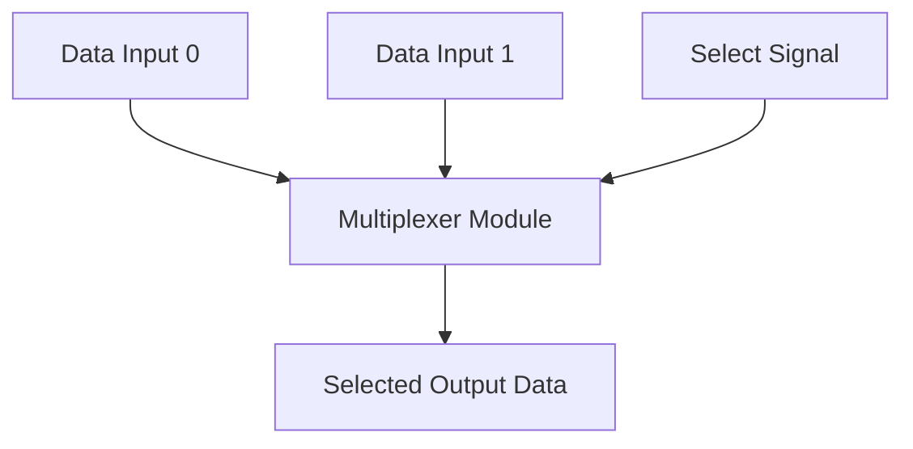

# SystemVerilog Multiplexer Design & Testbench

## Executive Summary
**SystemVerilog Multiplexer Design & Testbench** is a **Combinational Logic Design** project implemented in SystemVerilog/Verilog and verified using AMD/Xilinx Vivado Simulator.

Parametric Multiplexer (MUX) logic core implementation in SystemVerilog featuring configurable bit-widths and testbench validation.

---

## Architectural Block Diagram

---

## Core Key Features & Highlights

- 2-to-1 / 4-to-1 Multiplexer logic implementation.
- Non-blocking assign statements with minimal propagation delay.
- Comprehensive testbench (`mux_tb.sv`) verifying all select line combinations.

---

## Source Code & Module Index

| File Name | Module Name | Key Interface Signals |
| :--- | :--- | :--- |
| `mux_tb.sv` | `mux_tb` | Internal Module / Support File |
| `mux_1.sv` | `mux_1` | `a` (input), `b` (input), `select` (input) |

---

## Hardware Simulation & Verification Guide

### Prerequisites
- **AMD / Xilinx Vivado Design Suite** (2020.1 or newer recommended)
- **ModelSim / Icarus Verilog / GTKWave** (Optional alternative simulators)

### Step-by-Step Execution in Vivado
1. **Open Vivado IDE** and launch a new project.
2. Select **RTL Project** without specifying sources initially.
3. Choose your target FPGA Device (e.g. `xc7a35tcpg236-1` Artix-7 or generic).
4. Click **Add Sources** -> **Add or Create Design Sources** and add all `.sv` / `.v` / `.mem` files from this repository.
5. Set the primary top-level module (e.g. `TOP.sv` / `top.sv`) as **Top Module**.
6. Navigate to **Flow Navigator** -> **Simulation** -> **Run Simulation** -> **Run Behavioral Simulation**.
7. Observe the waveform outputs in `xsim` to confirm state transitions and signal behavior.

---

## Author & Contact Details

Developed and maintained by **Mohammad Usman Irshad**.

* **GitHub Profile**: [@usman-irshad1](https://github.com/usman-irshad1)
* **Email**: [217554659+usman-irshad1@users.noreply.github.com](mailto:217554659+usman-irshad1@users.noreply.github.com)
* **Domain**: Digital Design, Verilog/SystemVerilog HDL, Computer Architecture & RISC-V Processor Cores.
