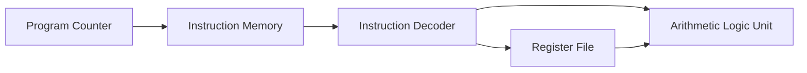

# Verilog ALU, Program Counter & Instruction Decoder Modules

## Executive Summary
**Verilog ALU, Program Counter & Instruction Decoder Modules** is a **Datapath Core Components** project implemented in SystemVerilog/Verilog and verified using AMD/Xilinx Vivado Simulator.

Integrated core modules featuring Program Counter (PC), Instruction Decoder, and Arithmetic Logic Unit (ALU).

---

## Architectural Block Diagram

---

## Core Key Features & Highlights

- 32-bit Program Counter with sequential increment logic.
- Arithmetic Logic Unit supporting Addition, Subtraction, Bitwise AND/OR.
- Header-driven modular instantiation pattern.

---

## Source Code & Module Index

| File Name | Module Name | Key Interface Signals |
| :--- | :--- | :--- |
| `PC.vh` | `PC.vh` | Internal Module / Support File |
| `register.vh` | `register.vh` | Internal Module / Support File |
| `ALU.vh` | `ALU.vh` | Internal Module / Support File |
| `instruction.vh` | `instruction.vh` | Internal Module / Support File |

---

## Hardware Simulation & Verification Guide

### Prerequisites
- **AMD / Xilinx Vivado Design Suite** (2020.1 or newer recommended)
- **ModelSim / Icarus Verilog / GTKWave** (Optional alternative simulators)

### Step-by-Step Execution in Vivado
1. **Open Vivado IDE** and launch a new project.
2. Select **RTL Project** without specifying sources initially.
3. Choose your target FPGA Device (e.g. `xc7a35tcpg236-1` Artix-7 or generic).
4. Click **Add Sources** -> **Add or Create Design Sources** and add all `.sv` / `.v` / `.mem` files from this repository.
5. Set the primary top-level module (e.g. `TOP.sv` / `top.sv`) as **Top Module**.
6. Navigate to **Flow Navigator** -> **Simulation** -> **Run Simulation** -> **Run Behavioral Simulation**.
7. Observe the waveform outputs in `xsim` to confirm state transitions and signal behavior.

---

## Author & Contact Details

Developed and maintained by **Mohammad Usman Irshad**.

* **GitHub Profile**: [@usman-irshad1](https://github.com/usman-irshad1)
* **Email**: [217554659+usman-irshad1@users.noreply.github.com](mailto:217554659+usman-irshad1@users.noreply.github.com)
* **Domain**: Digital Design, Verilog/SystemVerilog HDL, Computer Architecture & RISC-V Processor Cores.
