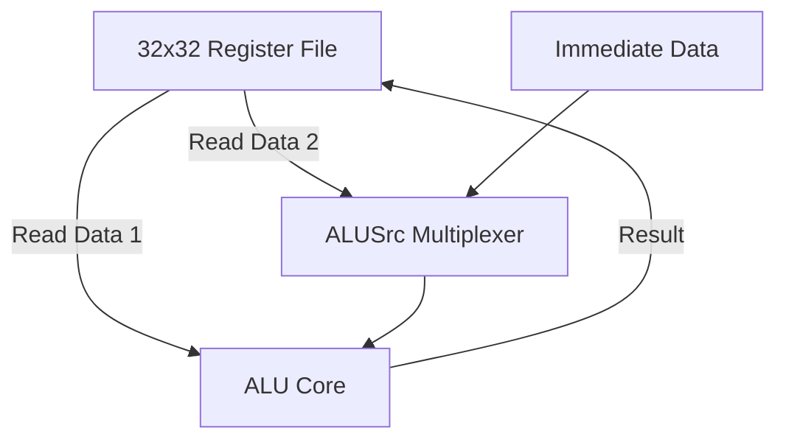

# Verilog Register File & ALU Execution Subsystem

## Executive Summary
**Verilog Register File & ALU Execution Subsystem** is a **Processor Datapath Subsystems** project implemented in SystemVerilog/Verilog and verified using AMD/Xilinx Vivado Simulator.

Integrated Register File and ALU execution subsystem with dynamic multiplexer routing.

---

## Architectural Block Diagram

---

## Core Key Features & Highlights

- Dual-read single-write 32x32-bit Register File.
- ALU execution block with control decoder.
- Interactive testbench verifying register read/write timing.

---

## Source Code & Module Index

| File Name | Module Name | Key Interface Signals |
| :--- | :--- | :--- |
| `reg.sv` | `Generic_pipeline_reg_reg` | `opcode` (input), `output logic` (input), `pc` (input) |
| `alu.sv` | `alu_control` | `ALU_op` (input), `input logic` (input), `fun11` (input) |
| `Alu_control.sv` | `ALU` | `ALU_control` (input), `input logic` (input), `data2` (input) |
| `mux_1.sv` | `MUX_1` | `data_from_reg2` (input), `input logic` (input), `data2` (output) |
| `final_2.sv` | `top` | `clock` (input), `input  logic        reset` (input), `output logic` (input) |
| `tb.sv` | `top_tb` | Internal Module / Support File |

---

## Hardware Simulation & Verification Guide

### Prerequisites
- **AMD / Xilinx Vivado Design Suite** (2020.1 or newer recommended)
- **ModelSim / Icarus Verilog / GTKWave** (Optional alternative simulators)

### Step-by-Step Execution in Vivado
1. **Open Vivado IDE** and launch a new project.
2. Select **RTL Project** without specifying sources initially.
3. Choose your target FPGA Device (e.g. `xc7a35tcpg236-1` Artix-7 or generic).
4. Click **Add Sources** -> **Add or Create Design Sources** and add all `.sv` / `.v` / `.mem` files from this repository.
5. Set the primary top-level module (e.g. `TOP.sv` / `top.sv`) as **Top Module**.
6. Navigate to **Flow Navigator** -> **Simulation** -> **Run Simulation** -> **Run Behavioral Simulation**.
7. Observe the waveform outputs in `xsim` to confirm state transitions and signal behavior.

---

## Author & Contact Details

Developed and maintained by **Mohammad Usman Irshad**.

* **GitHub Profile**: [@usman-irshad1](https://github.com/usman-irshad1)
* **Email**: [217554659+usman-irshad1@users.noreply.github.com](mailto:217554659+usman-irshad1@users.noreply.github.com)
* **Domain**: Digital Design, Verilog/SystemVerilog HDL, Computer Architecture & RISC-V Processor Cores.
