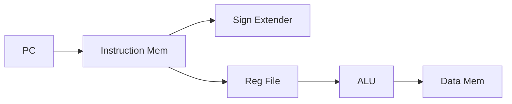

# Verilog Custom Datapath & Memory Controller Module

## Executive Summary
**Verilog Custom Datapath & Memory Controller Module** is a **Custom Hardware Systems** project implemented in SystemVerilog/Verilog and verified using AMD/Xilinx Vivado Simulator.

Custom Verilog processing core with integrated memory interface, sign extension unit, and ALU.

---

## Architectural Block Diagram

---

## Core Key Features & Highlights

- Immediate Sign Extension Unit.
- Data Memory read/write controller (`data_mem.sv`, `mux_data_mem.sv`).
- Component-level testbenches (`ALU_tb.sv`, `MUXtb.sv`, `top_tb.sv`).

---

## Source Code & Module Index

| File Name | Module Name | Key Interface Signals |
| :--- | :--- | :--- |
| `immediate_gen.sv` | `immediate_gen` | `ins` (input), `output logic` (input) |
| `pc.sv` | `program_counter` | `pc` (output), `input  logic clock` (output), `input  logic reset` (output) |
| `data_mem.mem` | `data_mem.mem` | Internal Module / Support File |
| `ins_file.mem` | `ins_file.mem` | Internal Module / Support File |
| `reg.mem` | `reg.mem` | Internal Module / Support File |
| `data_mem.sv` | `data_mem` | `opcode` (input), `input logic` (input), `rd` (output) |
| `Instruction_memory.sv` | `Instruction_memory` | `pc` (input), `output logic` (input), `r2` (output) |
| `ins_mem.sv` | `Instruction_memory` | `pc` (input), `output logic` (input), `r2` (output) |
| `mux_data_mem.sv` | `WB_MUX` | `alu_data` (input), `input logic` (input), `wb_data` (output) |
| `reg.sv` | `reg.sv` | Internal Module / Support File |
| `reg_file.sv` | `reg_file` | `rd` (input), `input logic` (input), `r1` (input) |
| `ALU.sv` | `ALU` | `opcode` (input), `input  logic` (input), `fun21` (input) |
| `ALU_tb.sv` | `ALU_tb` | Internal Module / Support File |
| `MUXtb.sv` | `MUX_tb` | `data_from_reg2
        data_from_reg2` (output) |
| `MUX.sv` | `MUX` | `data_from_reg2` (input), `input logic` (input), `opcode` (input) |
| `sign_extension.sv` | `Sign_extension` | `immediate` (input), `output logic` (input) |
| `top_tb.sv` | `top_tb` | Internal Module / Support File |
| `top.sv` | `top` | `pc` (output), `output logic` (output), `r2` (output) |
| `i_tb.sv` | `tb_Instruction_memory` | Internal Module / Support File |

---

## Hardware Simulation & Verification Guide

### Prerequisites
- **AMD / Xilinx Vivado Design Suite** (2020.1 or newer recommended)
- **ModelSim / Icarus Verilog / GTKWave** (Optional alternative simulators)

### Step-by-Step Execution in Vivado
1. **Open Vivado IDE** and launch a new project.
2. Select **RTL Project** without specifying sources initially.
3. Choose your target FPGA Device (e.g. `xc7a35tcpg236-1` Artix-7 or generic).
4. Click **Add Sources** -> **Add or Create Design Sources** and add all `.sv` / `.v` / `.mem` files from this repository.
5. Set the primary top-level module (e.g. `TOP.sv` / `top.sv`) as **Top Module**.
6. Navigate to **Flow Navigator** -> **Simulation** -> **Run Simulation** -> **Run Behavioral Simulation**.
7. Observe the waveform outputs in `xsim` to confirm state transitions and signal behavior.

---

## Author & Contact Details

Developed and maintained by **Mohammad Usman Irshad**.

* **GitHub Profile**: [@usman-irshad1](https://github.com/usman-irshad1)
* **Email**: [217554659+usman-irshad1@users.noreply.github.com](mailto:217554659+usman-irshad1@users.noreply.github.com)
* **Domain**: Digital Design, Verilog/SystemVerilog HDL, Computer Architecture & RISC-V Processor Cores.
