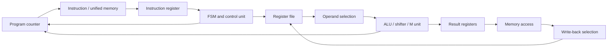

# RV32 Multi-Cycle RISC-V Processor

A multi-cycle, 32-bit RISC-V processor written in Verilog/SystemVerilog. The design is organized around an FSM-controlled datapath and includes arithmetic, shift, multiply, divide, and remainder logic. It is a computer-architecture project built to explore how instruction decode, control sequencing, register state, and execution units fit together in a processor.

This is a student project. The repository currently contains RTL and memory initialization files; it does not include a checked-in testbench, automated build script, or published FPGA resource/timing results. A source inspection also found multiple files declaring a module named `Control_unit` (`Control_unit.sv`, `cnonroel.sv`, and `fsm_control.sv`). These definitions need to be consolidated or separated in the project source set before a clean full-design compile can be claimed. Treat the instruction support described below as implementation intent until the integration issues are resolved and verified against tests.

## At a glance

- **Architecture:** 32-bit, multi-cycle datapath
- **Control:** FSM-based instruction sequencing
- **HDL:** Verilog/SystemVerilog (`.sv`)
- **Top-level module:** `top` in `TOP.sv`
- **Memory model:** unified instruction/data memory in `unified_mem.sv`, plus standalone instruction/data memory modules
- **Arithmetic:** ALU, shifter, and multiply/divide/remainder unit
- **Development tool:** AMD/Xilinx Vivado project flow

## Datapath overview

The top module connects the program counter, instruction memory, register file, immediate generator, ALU, multiply/divide unit, memory, control logic, and write-back path. The FSM sequences work across multiple cycles rather than completing every instruction in one cycle.

## Instruction support

The ALU decoder includes encodings for common RV32I arithmetic/logical operations and the RISC-V M-extension operations (MUL, MULH, MULHSU, MULHU, DIV, DIVU, REM, REMU). The repository does not yet include an ISA compliance suite or self-checking testbench, and the current top-level integration needs cleanup, so this list describes decode paths present in the RTL, not a claim of a working or compliant RV32IM core.

Before describing this core as RV32IM-compliant, verify all operations against the RISC-V specification, including signed/unsigned high-product results, divide-by-zero, signed overflow, and remainder corner cases. In particular, review the high/low result selection and register write-back behavior in `mul.sv` and `mul_mux_1.sv`.

## Repository layout

| File(s) | Purpose |
|---|---|
| `TOP.sv` | Integrates the processor as module `top` |
| `fsm_control.sv`, `Control_unit.sv`, `cnonroel.sv` | Instruction control and sequencing logic |
| `ALU.sv`, `ALU_con.sv`, `sll.sv` | Arithmetic/logical operations, decode, and shifting |
| `mul.sv`, `mul_mux_1.sv` | Multiply/divide/remainder datapath and result selection |
| `reg_mem.sv` | Register-file implementation |
| `immediate_gen.sv`, `pc.sv`, `pc_immediate.sv` | Immediate generation and program-counter path |
| `ins_mem.sv`, `data_mem.sv`, `unified_mem.sv` | Instruction/data memory models |
| `*_reg.sv`, `mux*.sv`, `place_holder.sv` | Pipeline/state registers and datapath selection logic |
| `*.mem` | Example memory/register initialization inputs |

Some module and file names are historical and may not match the module's role exactly. The table is a guide to the main components; inspect module declarations for exact port names and behavior.

## Open and simulate with Vivado

1. Clone the repository and open Vivado.
2. Create an RTL project and add the `.sv` sources and required `.mem` initialization files.
3. Set `top` (from `TOP.sv`) as the synthesis/design top.
4. To run behavioral simulation, add a testbench as the simulation top. **No testbench is currently included in this repository**, so one must be created before this step can produce a meaningful end-to-end check.
5. Ensure memory initialization paths resolve from the simulator's working directory, then inspect waveforms and compare architectural state with expected results.

The RTL has not been accompanied here by a reproducible command-line build, a checked-in Vivado project, or measured FPGA implementation results. Device-specific synthesis and timing claims should be added only after running and documenting those flows. Resolve the duplicate `Control_unit` declarations and align the top-level module's connections with the chosen control-unit interface before claiming the full design compiles.

## Verification roadmap

The most useful next step is a self-checking testbench that loads short instruction sequences and checks register/memory results. Start with reset and PC sequencing, then cover immediate and register arithmetic, branches, loads/stores, and each M-extension operation. Include directed corner cases for signedness and exceptional arithmetic, and record simulator/version plus run instructions.

## Author

Mohammad Usman Irshad · [GitHub profile](https://github.com/usman-irshad1)
