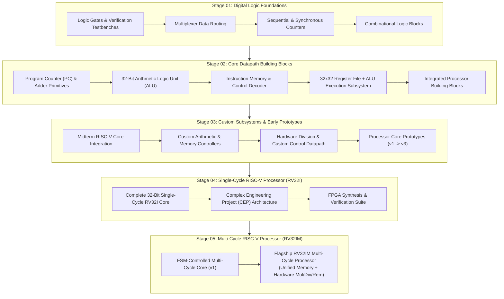
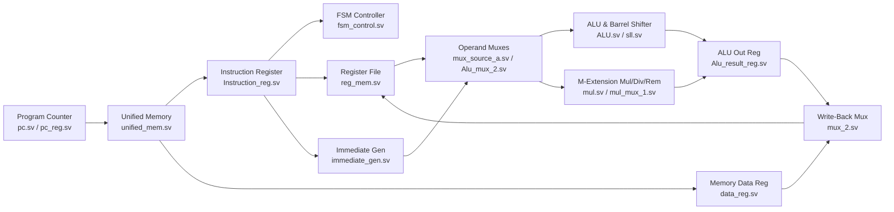

# RISC-V Processor Architecture & Digital Design Progression (`RV32I` / `RV32IM`)

[]()
[]()
[]()
[](LICENSE)

An end-to-end **Computer Architecture and Digital Logic Design** repository documenting the complete hardware engineering progression required to build a **32-bit RISC-V Processor** from scratch in **Verilog / SystemVerilog**.

Rather than scattering individual hardware labs and processor iterations across 21 separate repositories, this repository organizes the entire engineering journey into **5 sequential architectural stages**—showing exactly how fundamental combinational/sequential primitives were designed, verified, and incrementally integrated into a complete **Single-Cycle RV32I Core** and a **Multi-Cycle FSM-Controlled RV32IM Processor**.

---

## Architectural Progression Roadmap



---

## Stage-by-Stage Engineering Breakdown

### Stage 01 — Digital Logic Foundations (`01-Digital-Logic-Foundations/`)
Before designing instruction datapaths, fundamental combinational and sequential RTL primitives were implemented and verified using behavioral testbenches:

| Module Directory | Hardware Concepts Mastered | Key Takeaways for Processor Execution |
| :--- | :--- | :--- |
| [`01-Logic-Gates-and-Verification`](./01-Digital-Logic-Foundations/01-Logic-Gates-and-Verification) | Gate-level & behavioral SystemVerilog modeling, stimulus generation, waveform verification. | Established the simulation and testbench methodology used later for ALU and CPU verification. |
| [`02-Multiplexer-Routing`](./01-Digital-Logic-Foundations/02-Multiplexer-Routing) | Parameterized $N$-to-1 data selectors (`mux`). | Forms the basis for operand routing (`ALUSrc`), PC next-address selection (`PCSrc`), and write-back selection (`ResultSrc`). |
| [`03-Sequential-Counter-Practice`](./01-Digital-Logic-Foundations/03-Sequential-Counter-Practice) | Clocked flip-flops (`always_ff @(posedge clk)`), synchronous/asynchronous reset. | Direct precursor to the **Program Counter (`pc.sv`)** and architectural state registers. |
| [`04-Synchronous-Counter-Subsystem`](./01-Digital-Logic-Foundations/04-Synchronous-Counter-Subsystem) | Synchronous state transitions, enable strobes, and wrap-around timing. | Used to manage multi-cycle state sequencing and instruction address stepping (`PC + 4`). |
| [`05-Combinational-Logic-Module`](./01-Digital-Logic-Foundations/05-Combinational-Logic-Module) | Pure combinational datapath synthesis (`always_comb`) without unintended latches. | Essential for clean instruction decoding and immediate sign-extension logic. |

---

### Stage 02 — Core Datapath Building Blocks (`02-Datapath-Building-Blocks/`)
In Stage 02, standalone digital circuits were scaled to 32-bit architectural widths and connected into cohesive micro-subsystems:

| Module Directory | Architectural Component | Role in the RISC-V Execution Pipeline |
| :--- | :--- | :--- |
| [`01-ALU-and-PC-Primitives`](./02-Datapath-Building-Blocks/01-ALU-and-PC-Primitives) | Program Counter (`PC`), Instruction Memory lookup, and basic ALU operations. | Implements the **Instruction Fetch (IF)** loop: indexing instruction memory via `PC` and advancing `PC <= PC + 4`. |
| [`02-Arithmetic-Datapath-Unit`](./02-Datapath-Building-Blocks/02-Arithmetic-Datapath-Unit) | 32-bit Arithmetic & Logical execution unit (`ADD`, `SUB`, `AND`, `OR`, `XOR`, `SLT`). | Executes R-type and I-type computational instructions and generates branch comparison flags (`Zero`). |
| [`03-Control-Unit-and-Instruction-Memory`](./02-Datapath-Building-Blocks/03-Control-Unit-and-Instruction-Memory) | Opcode (`instr[6:0]`), `funct3`, and `funct7` instruction decoders. | Translates 32-bit machine code hex instructions into datapath control signals (`RegWrite`, `MemWrite`, `ALUControl`). |
| [`04-Register-File-and-ALU-Subsystem`](./02-Datapath-Building-Blocks/04-Register-File-and-ALU-Subsystem) | 32 $\times$ 32-bit dual-read, single-write **Register File (`x0`–`x31`)** coupled to the ALU. | Enables full **Read-Execute-WriteBack** register operations (`rs1`, `rs2` $\rightarrow$ ALU $\rightarrow$ `rd`) with hardwired `x0 = 0`. |
| [`05-Core-Processor-Building-Blocks`](./02-Datapath-Building-Blocks/05-Core-Processor-Building-Blocks) | Unified collection of ALU, Register File, Immediate Generator (`ImmGen`), and Data Memory. | Completes all individual leaf modules needed to assemble a working 32-bit RISC-V core. |

---

### Stage 03 — Custom Subsystems & Early Processor Prototypes (`03-Custom-Subsystems-and-Prototypes/`)
Stage 03 bridges the gap between isolated leaf modules and full processor integration, introducing custom arithmetic units (multiplication/division) and iterative core prototypes:

| Module Directory | Engineering Focus | Architectural Evolution |
| :--- | :--- | :--- |
| [`01-Midterm-RISC-V-Core-Integration`](./03-Custom-Subsystems-and-Prototypes/01-Midterm-RISC-V-Core-Integration) | First end-to-end integration of Instruction Memory, Register File, ALU, and Control Unit. | Validated single-cycle execution of basic R-type and I-type instruction sequences. |
| [`02-Custom-Arithmetic-Core`](./03-Custom-Subsystems-and-Prototypes/02-Custom-Arithmetic-Core) | Extended arithmetic core and dedicated register interface. | Explored specialized datapath extensions beyond basic add/subtract logic. |
| [`03-Custom-Datapath-and-Memory-Controller`](./03-Custom-Subsystems-and-Prototypes/03-Custom-Datapath-and-Memory-Controller) | Load/Store (`LW`/`SW`) memory controller and byte/word addressing logic. | Added the **Memory Access (MEM)** stage and write-back multiplexing between ALU results and Data Memory. |
| [`04-Division-Unit-and-Control-Datapath`](./03-Custom-Subsystems-and-Prototypes/04-Division-Unit-and-Control-Datapath) | Hardware division/remainder datapath and extended control decoding. | Prepared the arithmetic subsystem for the **RISC-V `M` (Multiply/Divide) Extension**. |
| [`05-Processor-Pipeline-Prototype-v1`](./03-Custom-Subsystems-and-Prototypes/05-Processor-Pipeline-Prototype-v1) | Early processor stage partitioning and inter-stage register buffering. | Investigated instruction staging and critical-path timing bottlenecks. |
| [`06-Processor-Core-Prototype-v3`](./03-Custom-Subsystems-and-Prototypes/06-Processor-Core-Prototype-v3) | Refined 32-bit RISC-V core prototype (`v3`) with full branch/jump target calculation. | Direct architectural stepping stone to the production Single-Cycle and Multi-Cycle cores. |

---

### Stage 04 — Single-Cycle RISC-V Processor (`04-Single-Cycle-RISC-V-Processor/`)
In Stage 04, all datapath and control subsystems are unified into complete **Single-Cycle 32-Bit RISC-V (`RV32I`) Processors**, where every instruction (`Fetch` $\rightarrow$ `Decode` $\rightarrow$ `Execute` $\rightarrow$ `Memory` $\rightarrow$ `Write-Back`) completes within a single clock cycle:

| Module Directory | Description | Highlights |
| :--- | :--- | :--- |
| [`01-RV32I-Single-Cycle-Core`](./04-Single-Cycle-RISC-V-Processor/01-RV32I-Single-Cycle-Core) | Complete 32-bit Single-Cycle RISC-V CPU Core in SystemVerilog/Verilog. | Separate Instruction & Data memories (Harvard-style), full `ImmGen` (I, S, B, U, J formats), branch comparator, and single-cycle control unit. |
| [`02-Complex-Engineering-Project-Architecture`](./04-Single-Cycle-RISC-V-Processor/02-Complex-Engineering-Project-Architecture) | Complex Engineering Project (CEP) RISC-V processor implementation. | Expanded instruction set coverage, structured datapath hierarchy, and verification memory programs (`.mem`). |
| [`03-FPGA-Synthesis-and-Verification-Pack`](./04-Single-Cycle-RISC-V-Processor/03-FPGA-Synthesis-and-Verification-Pack) | Top-level processor synthesis pack and verification suite. | Configured for Xilinx Vivado RTL synthesis, schematic inspection, and behavioral waveform verification. |

---

### Stage 05 — Multi-Cycle RISC-V Processor (`05-Multi-Cycle-RISC-V-Processor/`)
A single-cycle processor is limited by its longest critical path (typically a `LW` instruction traversing Instruction Memory $\rightarrow$ Register File $\rightarrow$ ALU $\rightarrow$ Data Memory $\rightarrow$ Register Write-Back in one clock period) and requires separate instruction and data memories.

In **Stage 05**, the architecture was redesigned into an **FSM-Controlled Multi-Cycle RISC-V (`RV32IM`) Processor**:

| Module Directory | Description | Key Architectural Advancements |
| :--- | :--- | :--- |
| [`01-FSM-Multi-Cycle-Core-v1`](./05-Multi-Cycle-RISC-V-Processor/01-FSM-Multi-Cycle-Core-v1) | First-generation Multi-Cycle RISC-V CPU Core with Finite State Machine (FSM) controller. | Breaks instruction execution across multiple clock cycles (`FETCH`, `DECODE`, `EXECUTE`, `MEM`, `WRITEBACK`) with non-architectural intermediate state registers (`Instruction_reg`, `data_reg`, `Alu_result_reg`). |
| [`02-Flagship-RV32IM-Multi-Cycle-Processor`](./05-Multi-Cycle-RISC-V-Processor/02-Flagship-RV32IM-Multi-Cycle-Processor) | **Flagship 32-bit Multi-Cycle RISC-V Processor** (`TOP.sv`) with Unified Memory and `M`-Extension datapath. | Combines **Unified Instruction/Data Memory (`unified_mem.sv`)**, an **FSM Sequencer (`fsm_control.sv`)**, barrel shifter (`sll.sv`), and a dedicated **Hardware Multiply/Divide/Remainder Unit (`mul.sv`, `mul_mux_1.sv`)** supporting `MUL`, `MULH`, `DIV`, and `REM` decode paths. |

#### Flagship Multi-Cycle Datapath (`05-Multi-Cycle-RISC-V-Processor/02-Flagship-RV32IM-Multi-Cycle-Processor`)



---

## How to Explore and Simulate in Xilinx Vivado

1. **Clone the Repository**:
   ```bash
   git clone https://github.com/usman-irshad1/risc-v-multicycle-processor.git
   cd risc-v-multicycle-processor
   ```
2. **Select Any Learning Stage or Processor Core**:
   - To inspect foundational modules, browse `01-Digital-Logic-Foundations/` or `02-Datapath-Building-Blocks/`.
   - To synthesize or simulate the **Single-Cycle Core**, open `04-Single-Cycle-RISC-V-Processor/01-RV32I-Single-Cycle-Core/`.
   - To synthesize or simulate the **Flagship Multi-Cycle Core**, open `05-Multi-Cycle-RISC-V-Processor/02-Flagship-RV32IM-Multi-Cycle-Processor/` (or use the root-level flagship RTL files) and set `top` (`TOP.sv`) as the top module in **AMD/Xilinx Vivado**.
3. **Ensure Memory Initialization (`.mem`) Files Are Loaded**:
   - Add `ins_file.mem`, `data_mem.mem`, and `reg.mem` to your Vivado simulation sources so instruction and register state initialize cleanly on reset.

---

## Author

**Mohammad Usman Irshad**  
[GitHub Profile (`@usman-irshad1`)](https://github.com/usman-irshad1)
