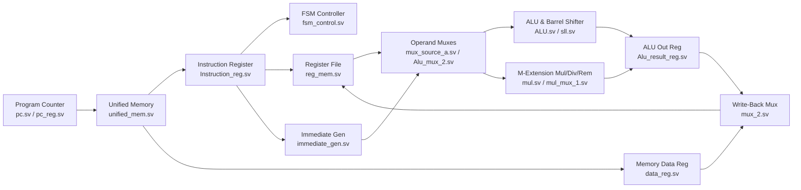
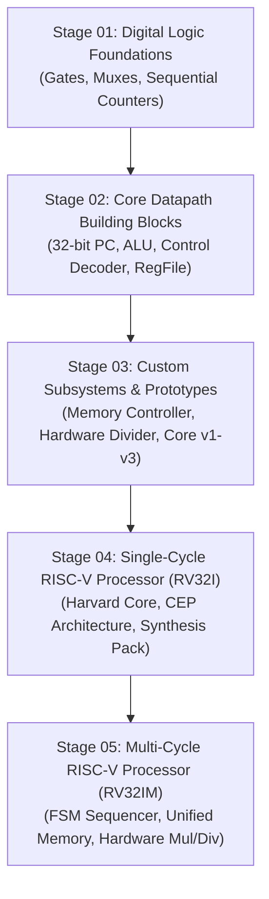

# RV32 Multi-Cycle & Single-Cycle RISC-V Processor Architecture (`RV32I` / `RV32IM`)

[](https://github.com/usman-irshad1/risc-v-multicycle-processor)
[](https://github.com/usman-irshad1/risc-v-multicycle-processor)
[](https://github.com/usman-irshad1/risc-v-multicycle-processor)
[](LICENSE)

A 32-bit **RISC-V Processor Architecture** written in **SystemVerilog / Verilog**, featuring both an **FSM-Controlled Multi-Cycle RV32IM Processor** (with unified instruction/data memory and hardware multiply/divide/remainder execution) and a **Single-Cycle RV32I Core**, along with the complete **5-stage digital design progression** showing how each hardware subsystem was built and verified.

---

## 1. Flagship Architecture: 32-Bit Multi-Cycle RISC-V Processor (`TOP.sv`)

Unlike a single-cycle processor (where the clock period is stretched to accommodate the slowest `LW` instruction path across separate instruction and data memories), the flagship multi-cycle design partitions instruction execution across multiple clock cycles controlled by a Finite State Machine (`fsm_control.sv`).

### Core Architectural Specifications
- **Datapath Width:** 32-bit registers (`x0`–`x31` in `reg_mem.sv`, with `x0` hardwired to `0`), 32-bit ALU (`ALU.sv`), and 32-bit Program Counter (`pc.sv`, `pc_reg.sv`).
- **Control Unit:** Multi-state FSM controller (`fsm_control.sv`) sequencing **Fetch (`IF`)**, **Decode (`ID`)**, **Execute (`EX`)**, **Memory Access (`MEM`)**, and **Write-Back (`WB`)** phases using intermediate non-architectural holding registers (`Instruction_reg.sv`, `data_reg.sv`, `Alu_result_reg.sv`).
- **Memory Hierarchy:** Unified Instruction and Data Memory (`unified_mem.sv`) initialized via `.mem` hex files (`ins_file.mem`, `data_mem.mem`, `reg.mem`), plus standalone instruction/data memory modules.
- **Execution Units:**
  - **Integer ALU & Barrel Shifter (`ALU.sv`, `ALU_con.sv`, `sll.sv`)**: Implements standard RV32I arithmetic, bitwise logical, shift, and branch comparison operations.
  - **Hardware Multiply / Divide / Remainder Unit (`mul.sv`, `mul_mux_1.sv`)**: Implements decode and execution paths for the RISC-V `M`-Extension (`MUL`, `MULH`, `MULHSU`, `MULHU`, `DIV`, `DIVU`, `REM`, `REMU`).



### Supported Instruction Encodings (Decode & Datapath Coverage)

| Instruction Class | Opcode (`instr[6:0]`) | Supported Operations in RTL | Datapath Modules |
| :--- | :---: | :--- | :--- |
| **R-Type (RV32I)** | `0110011` | `ADD`, `SUB`, `AND`, `OR`, `XOR`, `SLL`, `SRL`, `SRA`, `SLT`, `SLTU` | `ALU.sv`, `ALU_con.sv`, `sll.sv` |
| **R-Type (`M`-Extension)** | `0110011` (`funct7=0000001`) | `MUL`, `MULH`, `MULHSU`, `MULHU`, `DIV`, `DIVU`, `REM`, `REMU` | `mul.sv`, `mul_mux_1.sv`, `ALU_con.sv` |
| **I-Type (Immediate ALU)** | `0010011` | `ADDI`, `ANDI`, `ORI`, `XORI`, `SLLI`, `SRLI`, `SRAI`, `SLTI` | `immediate_gen.sv`, `Alu_mux_2.sv`, `ALU.sv` |
| **Load / Store** | `0000011` / `0100011` | `LW` (Load Word), `SW` (Store Word) | `unified_mem.sv`, `data_reg.sv`, `write_mem_reg.sv` |
| **Branch / Jump** | `1100011` / `1101111` | `BEQ`, `BNE`, `BLT`, `BGE`, `JAL` | `pc_immediate.sv`, `mux_source_a.sv`, `fsm_control.sv` |

> **Integration & Verification Note:** The root directory contains three iterations of the control module (`fsm_control.sv`, `Control_unit.sv`, and `cnonroel.sv`) that declare `module Control_unit`. When creating a Vivado project from the root sources, include **only one** control unit file (e.g., `fsm_control.sv`) in the active synthesis/simulation source set, or use the pre-packaged testbench suites in `04-Single-Cycle-RISC-V-Processor/03-FPGA-Synthesis-and-Verification-Pack/` (`tb.sv`, `tb_top_processor_time_impl.v`) and `05-Multi-Cycle-RISC-V-Processor/01-FSM-Multi-Cycle-Core-v1/tb.sv`.

---

## 2. Quick-Start: Simulate & Verify in AMD/Xilinx Vivado

### A. Simulate the Multi-Cycle RISC-V Core with Self-Checking Testbench (`tb.sv`)
1. Clone the repository:
   ```bash
   git clone https://github.com/usman-irshad1/risc-v-multicycle-processor.git
   cd risc-v-multicycle-processor
   ```
2. Launch **AMD/Xilinx Vivado** and click **Create Project $\rightarrow$ RTL Project**.
3. Add all `.sv`/`.v` design sources and `.mem` initialization files (`unified_memory.mem`, `reg.mem`) from [`05-Multi-Cycle-RISC-V-Processor/01-FSM-Multi-Cycle-Core-v1/`](./05-Multi-Cycle-RISC-V-Processor/01-FSM-Multi-Cycle-Core-v1) (or [`04-Single-Cycle-RISC-V-Processor/03-FPGA-Synthesis-and-Verification-Pack/`](./04-Single-Cycle-RISC-V-Processor/03-FPGA-Synthesis-and-Verification-Pack) for post-synthesis timing verification).
4. Set `Top` (`Top.sv`) as the Design Top Module and `tb` ([`tb.sv`](./05-Multi-Cycle-RISC-V-Processor/01-FSM-Multi-Cycle-Core-v1/tb.sv)) as the Simulation Top Module.
5. Click **Run Simulation $\rightarrow$ Run Behavioral Simulation** and inspect the waveform transitions across `PC`, `Instruction_reg`, `ALU_out`, and the `reg` register file array.

### B. Root Flagship Module Inventory
| File(s) | Purpose |
| :--- | :--- |
| [`TOP.sv`](TOP.sv) | Top-level processor integration wrapper (`module top`) |
| [`fsm_control.sv`](fsm_control.sv), [`Control_unit.sv`](Control_unit.sv) | Multi-cycle FSM state controller and instruction decoder |
| [`ALU.sv`](ALU.sv), [`ALU_con.sv`](ALU_con.sv), [`sll.sv`](sll.sv) | 32-bit arithmetic/logical execution unit, ALU decoder, and barrel shifter |
| [`mul.sv`](mul.sv), [`mul_mux_1.sv`](mul_mux_1.sv) | Hardware multiply, divide, and remainder datapath and result selector |
| [`reg_mem.sv`](reg_mem.sv), [`reg.mem`](reg.mem) | 32 $\times$ 32-bit dual-read, single-write Register File and initial register values |
| [`immediate_gen.sv`](immediate_gen.sv), [`pc.sv`](pc.sv), [`pc_immediate.sv`](pc_immediate.sv) | Immediate sign-extension generator and Program Counter adder path |
| [`unified_mem.sv`](unified_mem.sv), [`ins_mem.sv`](ins_mem.sv), [`data_mem.sv`](data_mem.sv) | Unified and split instruction/data memory modules initialized by [`ins_file.mem`](ins_file.mem) and [`data_mem.mem`](data_mem.mem) |
| [`Instruction_reg.sv`](Instruction_reg.sv), [`data_reg.sv`](data_reg.sv), [`Alu_result_reg.sv`](Alu_result_reg.sv) | Multi-cycle inter-stage state registers (`IR`, `MDR`, `ALUOut`) |

---

## 3. 5-Stage Hardware Learning & Development Progression

To document how each digital logic concept and subsystem was mastered prior to full processor integration, all 21 hardware modules and processor iterations are organized chronologically across 5 stage directories:



### Stage 01 — Digital Logic Foundations ([`01-Digital-Logic-Foundations/`](./01-Digital-Logic-Foundations))
| Module Directory | Hardware Concepts Mastered | Role in Final Processor |
| :--- | :--- | :--- |
| [`01-Logic-Gates-and-Verification`](./01-Digital-Logic-Foundations/01-Logic-Gates-and-Verification) | Behavioral SystemVerilog modeling & stimulus testbenches | Established waveform verification methodology |
| [`02-Multiplexer-Routing`](./01-Digital-Logic-Foundations/02-Multiplexer-Routing) | Parameterized $N$-to-1 data routing (`mux`) | Operand (`ALUSrc`), `PCSrc`, and write-back (`ResultSrc`) routing |
| [`03-Sequential-Counter-Practice`](./01-Digital-Logic-Foundations/03-Sequential-Counter-Practice) | Clocked flip-flops (`always_ff`) & reset logic | Foundation for Program Counter (`pc_reg.sv`) and state registers |
| [`04-Synchronous-Counter-Subsystem`](./01-Digital-Logic-Foundations/04-Synchronous-Counter-Subsystem) | Synchronous state transitions & enable strobes | Used in multi-cycle FSM state sequencing |
| [`05-Combinational-Logic-Module`](./01-Digital-Logic-Foundations/05-Combinational-Logic-Module) | Latch-free combinational logic (`always_comb`) | Used in instruction decoding and immediate generation |

### Stage 02 — Core Datapath Building Blocks ([`02-Datapath-Building-Blocks/`](./02-Datapath-Building-Blocks))
| Module Directory | Architectural Component | Role in Final Processor |
| :--- | :--- | :--- |
| [`01-ALU-and-PC-Primitives`](./02-Datapath-Building-Blocks/01-ALU-and-PC-Primitives) | Program Counter (`PC`), Instruction Memory lookup, basic ALU | Implements the Instruction Fetch (`IF`) loop (`PC <= PC + 4`) |
| [`02-Arithmetic-Datapath-Unit`](./02-Datapath-Building-Blocks/02-Arithmetic-Datapath-Unit) | 32-bit Arithmetic Logic Unit (`ADD`, `SUB`, `AND`, `OR`, `XOR`, `SLT`) | Executes R-type/I-type instructions and branch `Zero` flags |
| [`03-Control-Unit-and-Instruction-Memory`](./02-Datapath-Building-Blocks/03-Control-Unit-and-Instruction-Memory) | Opcode (`instr[6:0]`), `funct3`, and `funct7` decoders | Generates datapath control strobes (`RegWrite`, `MemWrite`, `ALUControl`) |
| [`04-Register-File-and-ALU-Subsystem`](./02-Datapath-Building-Blocks/04-Register-File-and-ALU-Subsystem) | 32 $\times$ 32-bit dual-read, single-write Register File + ALU | Enables full `rs1`/`rs2` read $\rightarrow$ execute $\rightarrow$ `rd` write-back loop |
| [`05-Core-Processor-Building-Blocks`](./02-Datapath-Building-Blocks/05-Core-Processor-Building-Blocks) | Complete leaf modules (`ALU`, `RegFile`, `ImmGen`, `DataMem`) | Provides all leaf components required for single-cycle assembly |

### Stage 03 — Custom Subsystems & Early Prototypes ([`03-Custom-Subsystems-and-Prototypes/`](./03-Custom-Subsystems-and-Prototypes))
| Module Directory | Engineering Focus | Architectural Evolution |
| :--- | :--- | :--- |
| [`01-Midterm-RISC-V-Core-Integration`](./03-Custom-Subsystems-and-Prototypes/01-Midterm-RISC-V-Core-Integration) | First integrated Instruction Memory + RegFile + ALU + Control core | Verified end-to-end execution of basic R-type and I-type sequences |
| [`02-Custom-Arithmetic-Core`](./03-Custom-Subsystems-and-Prototypes/02-Custom-Arithmetic-Core) | Extended arithmetic core and register interface | Explored specialized datapath extensions |
| [`03-Custom-Datapath-and-Memory-Controller`](./03-Custom-Subsystems-and-Prototypes/03-Custom-Datapath-and-Memory-Controller) | Load/Store (`LW`/`SW`) memory controller | Added Memory Access (`MEM`) stage and write-back multiplexing |
| [`04-Division-Unit-and-Control-Datapath`](./03-Custom-Subsystems-and-Prototypes/04-Division-Unit-and-Control-Datapath) | Hardware division/remainder datapath | Prepared the arithmetic subsystem for the RISC-V `M`-Extension |
| [`05-Processor-Pipeline-Prototype-v1`](./03-Custom-Subsystems-and-Prototypes/05-Processor-Pipeline-Prototype-v1) & [`06-v3`](./03-Custom-Subsystems-and-Prototypes/06-Processor-Core-Prototype-v3) | Iterative processor core prototypes (`v1` $\rightarrow$ `v3`) | Refined branch target calculation and inter-stage register buffering |

### Stage 04 — Single-Cycle RISC-V Processor ([`04-Single-Cycle-RISC-V-Processor/`](./04-Single-Cycle-RISC-V-Processor))
- **[`01-RV32I-Single-Cycle-Core`](./04-Single-Cycle-RISC-V-Processor/01-RV32I-Single-Cycle-Core)**: Complete 32-bit Single-Cycle RISC-V CPU Core with separate instruction and data memories.
- **[`02-Complex-Engineering-Project-Architecture`](./04-Single-Cycle-RISC-V-Processor/02-Complex-Engineering-Project-Architecture)**: Extended CEP RISC-V processor implementation with custom test programs.
- **[`03-FPGA-Synthesis-and-Verification-Pack`](./04-Single-Cycle-RISC-V-Processor/03-FPGA-Synthesis-and-Verification-Pack)**: Includes behavioral testbench ([`tb.sv`](./04-Single-Cycle-RISC-V-Processor/03-FPGA-Synthesis-and-Verification-Pack/tb.sv)) and post-implementation timing simulation model ([`tb_top_processor_time_impl.v`](./04-Single-Cycle-RISC-V-Processor/03-FPGA-Synthesis-and-Verification-Pack/tb_top_processor_time_impl.v)).

### Stage 05 — Multi-Cycle RISC-V Processor ([`05-Multi-Cycle-RISC-V-Processor/`](./05-Multi-Cycle-RISC-V-Processor))
- **[`01-FSM-Multi-Cycle-Core-v1`](./05-Multi-Cycle-RISC-V-Processor/01-FSM-Multi-Cycle-Core-v1)**: First-generation FSM-controlled Multi-Cycle core with unified memory (`Unified_mem.sv`) and testbench (`tb.sv`).
- **[`02-Flagship-RV32IM-Multi-Cycle-Processor`](./05-Multi-Cycle-RISC-V-Processor/02-Flagship-RV32IM-Multi-Cycle-Processor)**: Flagship 32-bit Multi-Cycle RISC-V architecture with unified memory and hardware multiply/divide/remainder unit.

---

## Author & License

- **Author:** Mohammad Usman Irshad ([@usman-irshad1](https://github.com/usman-irshad1))
- **License:** Distributed under the [MIT License](LICENSE).
