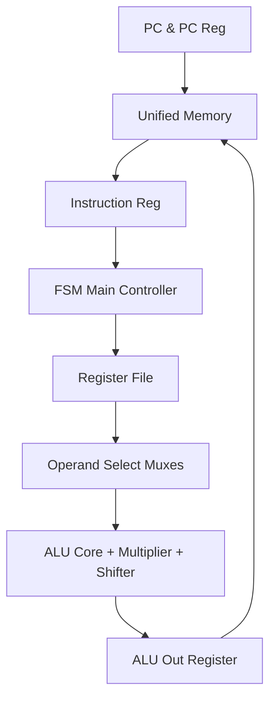

# Flagship 32-Bit Multi-Cycle RISC-V Processor with Hardware Multiplier

## Executive Summary
**Flagship 32-Bit Multi-Cycle RISC-V Processor with Hardware Multiplier** is a **Flagship CPU Architecture** project implemented in SystemVerilog/Verilog and verified using AMD/Xilinx Vivado Simulator.

Flagship 32-bit Multi-Cycle RISC-V Processor Core featuring FSM control, Hardware Multiplier, Shift Unit, and Unified Memory Architecture.

---

## Architectural Block Diagram

---

## Core Key Features & Highlights

- Multi-Cycle FSM Control Unit (`Control_unit.sv`, `fsm_control.sv`).
- Hardware Multiplier (`mul.sv`) and Shift Logic (`sll.sv`).
- Comprehensive 31-module architecture with individual stage registers.
- Complete Top-level Processor Module (`TOP.sv`) and testbench verification.

---

## Source Code & Module Index

| File Name | Module Name | Key Interface Signals |
| :--- | :--- | :--- |
| `immediate_gen.sv` | `immediate_gen` | `ins` (input), `output logic` (input) |
| `pc.sv` | `program_counter` | `pc` (output), `input  logic` (output), `clock` (input) |
| `pc_immediate.sv` | `pc_immediate` | `pc_1` (input), `output logic` (input), `dataW` (input) |
| `pc_reg.sv` | `pc_reg` | `next_pc` (input), `input logic clock` (input), `input logic reset` (input) |
| `data_mem.mem` | `data_mem.mem` | Internal Module / Support File |
| `data_mem.sv` | `data_mem` | `rd` (output), `input logic` (output), `clock` (input) |
| `ins_file.mem` | `ins_file.mem` | Internal Module / Support File |
| `ins_mem.sv` | `Instruction_memory` | `pc_byte_address` (input), `output logic` (input), `r2` (output) |
| `reg.mem` | `reg.mem` | Internal Module / Support File |
| `reg_mem.sv` | `reg_file` | `rd` (input), `input logic` (input), `r1` (input) |
| `unified_mem.sv` | `Unified_Memory` | `clock` (input), `input logic` (input), `r1_out` (output) |
| `write_mem_reg.sv` | `write_back_reg` | `data` (input), `input logic clock` (input), `input logic reset` (input) |
| `Alu_result_reg.sv` | `Alu_result_reg` | `alu_result` (input), `input logic clock` (input), `input logic reset` (input) |
| `data_reg.sv` | `data_reg` | `data1` (input), `input logic` (input), `clock` (input) |
| `Instruction_reg.sv` | `Instruction_reg` | `old_pc` (input), `input logic` (input), `clock` (input) |
| `ALU.sv` | `ALU` | `ALU_control` (input), `input logic` (input), `data2` (input) |
| `ALU_con.sv` | `alu_control` | `ALU_op` (input), `input logic` (input), `fun11` (input) |
| `Alu_mux_2.sv` | `ALU_source2` | `data2` (input), `immediate` (input), `input logic` (input) |
| `ALU_output.sv` | `ALU_output` | `Alu_result` (input), `input logic` (input), `ALU_output` (output) |
| `mul.sv` | `multiplication_module` | `ALU_control` (input), `input  logic` (input), `data2` (input) |
| `mul_mux_1.sv` | `mul_mux` | `ALU_control` (input), `output logic` (input), `alu_1` (input) |
| `sll.sv` | `sll` | `immediate` (input), `output logic` (input) |
| `mux.sv` | `mux_3` | `zero` (input), `input branch` (input), `input logic` (input) |
| `mux_1.sv` | `MUX_1` | `data_from_reg2` (input), `input logic` (input), `data2` (output) |
| `mux_2.sv` | `MUX_2` | `alu_data` (input), `input  logic` (input), `mem_to_reg` (input) |
| `mux_source_a.sv` | `mux_source_a` | Internal Module / Support File |
| `Control_unit.sv` | `Control_unit` | `opcode` (input), `output logic memread` (input), `output logic memwrite` (input) |
| `fsm_control.sv` | `Control_unit` | `opcode` (input), `input logic` (input), `fun11` (input) |
| `cnonroel.sv` | `Control_unit` | `opcode` (input), `input logic` (input), `fun11` (input) |
| `place_holder.sv` | `ALU_source1` | `data1` (input), `pc` (input), `old_pc` (input) |
| `TOP.sv` | `top` | `clock` (input), `input logic reset` (input), `output logic` (input) |

---

## Hardware Simulation & Verification Guide

### Prerequisites
- **AMD / Xilinx Vivado Design Suite** (2020.1 or newer recommended)
- **ModelSim / Icarus Verilog / GTKWave** (Optional alternative simulators)

### Step-by-Step Execution in Vivado
1. **Open Vivado IDE** and launch a new project.
2. Select **RTL Project** without specifying sources initially.
3. Choose your target FPGA Device (e.g. `xc7a35tcpg236-1` Artix-7 or generic).
4. Click **Add Sources** -> **Add or Create Design Sources** and add all `.sv` / `.v` / `.mem` files from this repository.
5. Set the primary top-level module (e.g. `TOP.sv` / `top.sv`) as **Top Module**.
6. Navigate to **Flow Navigator** -> **Simulation** -> **Run Simulation** -> **Run Behavioral Simulation**.
7. Observe the waveform outputs in `xsim` to confirm state transitions and signal behavior.

---

---

## Speech Therapy & Assistive Biomedical Application

### Real-World Engineering Purpose
This RISC-V processor architecture was engineered as part of a **Complex Engineering Project (CEP)** focused on **Speech Therapy & Assistive Acoustic Processing**:

- **Real-Time Speech Signal Processing**: Designed to execute digital signal processing (DSP) algorithms for speech rehabilitation, pitch detection, and acoustic formant tracking.
- **Hardware Acceleration for Vocal Feedback**: Leverages onboard Hardware Multipliers (`Mul.sv`) and high-speed ALU logic to calculate real-time frequency analysis and vocal intensity feedback for speech pathology patients.
- **Assistive Biomedical Embedded Processor**: Functions as an energy-efficient embedded controller for wearable or portable speech training devices assisting patients with articulation disorders and vocal rehabilitation.

## Author & Contact Details

Developed and maintained by **Mohammad Usman Irshad**.

* **GitHub Profile**: [@usman-irshad1](https://github.com/usman-irshad1)
* **Email**: [217554659+usman-irshad1@users.noreply.github.com](mailto:217554659+usman-irshad1@users.noreply.github.com)
* **Domain**: Digital Design, Verilog/SystemVerilog HDL, Computer Architecture & RISC-V Processor Cores.
